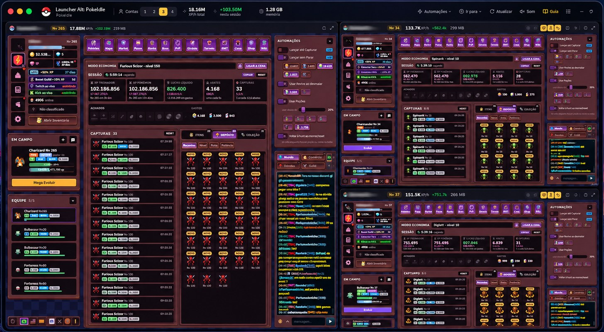
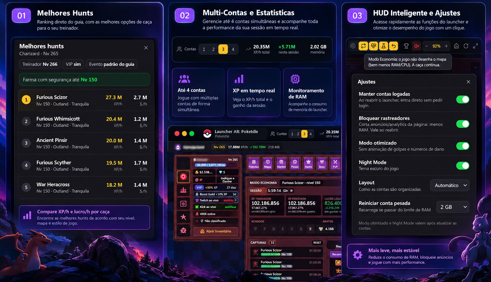
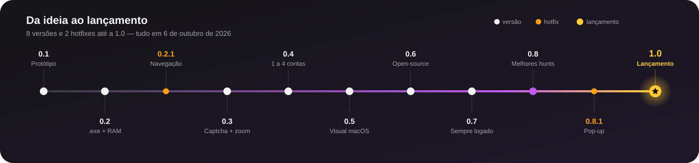
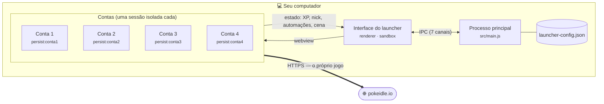

<p align="center">
  
</p>

<p align="center">
  
  
  
  
  
</p>

<p align="center">
  <a href="#-download">Download</a> ·
  <a href="#-funcionalidades">Funcionalidades</a> ·
  <a href="#-da-ideia-ao-lançamento">Versões</a> ·
  <a href="#-segurança-e-privacidade">Segurança</a> ·
  <a href="#-como-funciona-por-dentro">Como funciona</a> ·
  <a href="#-compilar-a-partir-do-código">Compilar</a> ·
  <a href="#-perguntas-frequentes">FAQ</a> ·
  <a href="#-apoie-o-projeto">Apoie</a>
</p>

---

O **Pokéidle.io** permite jogar com até **4 contas** — normalmente uma principal e três alts para farmar. Fazer isso no navegador significa quatro perfis diferentes, quatro janelas e nenhuma visão geral.

O **Launcher Alt: PokeIdle** junta tudo em **uma única janela**: cada conta roda isolada no seu próprio card, você vê o XP/h de todas ao mesmo tempo, liga automações em todas com um clique e acompanha quanta memória cada uma está usando.

> **Tudo roda no seu computador.** O launcher não tem servidor, não coleta dados, não envia nada para lugar nenhum e não toca na sua senha. O código está todo aqui para você conferir.

<p align="center">
  
  <br>
  <sub>3 contas farmando lado a lado — a principal em destaque, XP/h total, XP da sessão e memória sempre à vista.</sub>
</p>

## ✨ Funcionalidades

<p align="center">
  
  <br>
  <sub><b>01</b> Onde caçar: as melhores hunts para o seu pokémon · <b>02</b> Multi-contas e estatísticas em tempo real · <b>03</b> HUD inteligente e ajustes de desempenho</sub>
</p>

| | |
|---|---|
| **1 a 4 contas** | Escolha quantas contas rodar no seletor do topo. Contas desligadas não abrem e não usam memória. |
| **Contas isoladas** | Cada conta tem sua própria sessão (como um perfil de navegador separado). |
| **Sempre logado** | Logou uma vez, fechou o launcher, abriu no dia seguinte: as contas entram direto, sem pedir login. Se o jogo descartar a sessão por uma falha passageira na abertura, o launcher a devolve sozinho. |
| **Abertura escalonada** | Ao abrir, as contas entram uma a cada 3 segundos, em vez de todas juntas — menos pico de CPU/RAM e menos falhas de captcha. |
| **Captcha que se recupera** | Se aparecer "Não deu para confirmar que você não é um robô", a conta é recarregada sozinha (até 3 vezes em 5 min). |
| **Layout inteligente** | 2×2 com 4 contas, principal em destaque com 3, lado a lado com 2. Também há "lado a lado" e "empilhado". |
| **Zoom automático** | O jogo se ajusta sozinho ao tamanho de cada card, com a HUD inteira visível. Dá para ajustar à mão por conta. |
| **Onde caçar?** 🏆 | Um clique no troféu (ou em **Onde caçar** na barra) e o launcher simula o **seu** pokémon em campo contra cada hunt liberada, com as fórmulas de combate do próprio jogo: top 10 por XP/h, abates/h e risco. O ritmo de cada hunt é **medido de verdade** na sua conta depois de 10 min caçando nela. Não roda nada em segundo plano: o cálculo só acontece quando você abre o painel. |
| **Caça shiny** ✨ | A melhor hunt para capturar um shiny com o seu pokémon e a chance de conseguir em 1, 7 e 30 dias, com a Beast Ball e com a melhor bola que se compra com ouro — e o tempo médio com Capture Boost e Shiny Lure. Pelas regras do jogo: o shiny é sorteado em cada bola (uma por corpo), então vale matar rápido e caçar espécies de 1º estágio; na Outland o shiny não rola. |
| **Outland & renda** 💎 | Quanto cada conta tira por dia em **Bronze Boss Tokens** e **fragmentos** (Chave, Shiny Stone, Bicicleta) na Outland mais rápida para o seu pokémon, com o seu tier e bônus de loot — em Gemas (já sem a taxa do Mercado), em USDT e em dias até o saque mínimo. Os preços vêm do **Mercado da Comunidade**: abriu o mercado em qualquer conta, o launcher guarda o menor anúncio. Avisa quando você já libera um tier melhor. |
| **Farm que não para** 🩺 | O farm roda no servidor enquanto a conexão de cada conta estiver viva. O launcher mantém essa conexão de pé com o launcher minimizado ou coberto, **vigia a conexão** (90 s sem resposta do servidor → reconecta; se não voltar → recarrega a conta), **reconecta tudo na volta do sono/hibernação**, destrava XP parado por 15 min e faz uma atualização preventiva a cada 6 h. Conta aberta em outro lugar nunca é tomada de volta sozinha. |
| **Sem cena quando ausente** | PC ausente ou launcher minimizado: a cena das contas sai (bem menos RAM/CPU, a caça continua) e volta quando você volta. |
| **Farmar com o Windows bloqueado** | Ligado por padrão. Bloqueou com **Win+L**? Enquanto estiver bloqueado, o PC não entra em espera sozinho (a tela apaga normalmente) e as contas seguem farmando, sem cena. Desbloqueou, volta tudo ao normal. |
| **Não deixar o PC dormir** | Opcional (desligado). Em muitos notebooks, a tela apagar por ausência já põe o PC em espera e congela os programas — e o jogo não farma offline. Ligado, só a tela apaga e as contas seguem farmando a noite toda. |
| **Animação a 30 FPS** | Desenha a cena na metade dos quadros: metade do esforço de CPU/GPU, e a caça não muda (o jogo move tudo pelo tempo, não pelo quadro). |
| **XP/h em tempo real** | Por conta e somado, calculado sobre os últimos 10 minutos, mais o XP ganho na sessão. |
| **Automações** | Liga/desliga *Lançar até capturar*, *Lançar sem parar*, *Revive*, *Poções* e *Voltar à hunt* — por conta ou em todas de uma vez. O launcher lembra suas escolhas e as reaplica quando a conta loga. |
| **Ir para** | Abre Mapa, Market, Boss, Pokedex, Mini Games etc. em todas as contas (ou só na que está em foco). |
| **Modo otimizado e Night Mode** | Ficam sempre ligados em todas as contas (pode desligar nos Ajustes). |
| **Modo Economia (sem cena)** | Um clique na folha liga ou desliga a cena daquela conta usando os **próprios botões do jogo** — ou em todas de uma vez, pelo menu Automações. Sem cena, o jogo para de desenhar, solta o mapa da memória e o servidor deixa de mandar o campo: a caça continua e o consumo cai bastante. Ideal para alts. |
| **Monitor de memória** | RAM total e por conta, com reinício automático opcional de uma conta que passar do limite. |
| **Bloqueio de rastreadores** | Corta os scripts de anúncio/analytics (Google Analytics, Tag Manager, Pixel do Facebook): menos RAM e mais privacidade. O aviso de cookies do jogo é respondido com "Recusar" (só se você ainda não escolheu), e a faixa deixa de cobrir o rodapé. |
| **Mudo de verdade** | Conta no mudo desliga o som dentro do jogo, que deixa de tocar e decodificar áudio. |
| **Foco** | Expanda uma conta para a janela inteira; as outras continuam farmando. |
| **À prova de queda** | Se o jogo de uma conta travar, só aquele card recarrega sozinho (com login e automações). O modo "pop-up" do jogo (Picture-in-Picture) fica desligado no launcher, porque derrubava a janela; no lugar dele o jogo mostra o cartão dentro da página. |
| **Nomes salvos** | Renomeie cada card com o nick da conta; se deixar o nome padrão, o launcher usa o nick do jogo. |

## 🚀 Da ideia ao lançamento

<p align="center">
  
</p>

O launcher nasceu de uma ideia simples — *"e se as 4 contas coubessem numa janela só?"* — e foi lapidado versão a versão, testado de verdade no farm, até chegar à 1.0. Cada etapa:

<details open>
<summary><b>✨ 1.3 — Caça shiny</b> · a melhor hunt e a chance por tempo</summary>

<br>

- Nova aba no "Onde caçar?": onde o seu pokémon tem mais chance de capturar um shiny, a probabilidade em 1, 7 e 30 dias com a Beast Ball e com a melhor bola de ouro, e quanto os boosts encurtam a espera.
</details>

<details>
<summary><b>💎 1.2 — Onde caçar e renda da Outland</b> · calculadora própria, sem extensão</summary>

<br>

- **Onde caçar? próprio:** a extensão /hunt parou de funcionar com o jogo novo, então o launcher ganhou o seu motor: simula o seu pokémon em cada hunt com as fórmulas do Pokepédia do jogo, importadas ao vivo dos módulos do próprio jogo, e mede o ritmo real de cada conta.
- **Outland & renda:** Boss Tokens e fragmentos por dia, em Gemas e USDT, com os preços do Mercado da Comunidade.
- **Jogo v1.401:** "Ir para" acompanha os rótulos novos (Pokedex, Mini Games). Sai a extensão e o download diário da Chrome Web Store.
</details>

<details>
<summary><b>🩹 1.1.1 — Hotfix: farm que não para</b> · PC ausente não derruba mais as contas</summary>

<br>

- **O problema:** em notebooks com *Modern Standby*, ficar ausente faz a tela apagar e o Windows entrar em espera, congelando os programas: a conexão cai e o servidor para a hunt (o jogo não tem farm offline).
- **A correção:** o launcher **vigia a conexão** de cada conta e reconecta (ou recarrega) sozinho, **reconecta tudo na volta da espera** e oferece **"Não deixar o PC dormir"** para farmar ausente com a tela apagada.
- **Menos RAM:** "Sem cena quando ausente" e o /hunt opcional (substituído pela calculadora própria na 1.2).
</details>

<details>
<summary><b>🔧 1.1 — Acompanhando o jogo</b> · depois do lançamento</summary>

<br>

O jogo atualizou e o launcher foi junto:

- **/hunt oficial embutido:** o guia virou a extensão oficial *"/hunt for PokeIdle"*, que passou a rodar dentro das contas (removida na 1.2, quando parou de funcionar).
- **Cena sem bug:** ligar e desligar o Modo Economia às vezes travava até reiniciar o launcher. Agora o launcher usa os botões do próprio jogo e não briga mais com ele. Também dá para tirar a cena de todas as contas de uma vez.
- **Saúde das contas:** destrava sozinho a conta cujo XP parou e faz uma atualização preventiva a cada 6 h — sempre só quando você não está mexendo nela.
- **Animação a 30 FPS** e **aviso de cookies respondido sozinho** (com os rastreadores bloqueados).
</details>

<details>
<summary><b>⭐ 1.0 — Lançamento</b> · a versão pública</summary>

<br>

Tudo o que veio antes, reunido numa versão só — com a base testada numa **noite inteira de farm sem parar**. Código aberto, executável portátil gerado pelo GitHub Actions e documentação completa de segurança e privacidade.
</details>

<details>
<summary><b>🩹 0.8.1 — Hotfix: pop-up</b> · nada de janela caindo</summary>

<br>

- O botão de **pop-up** do jogo (Picture-in-Picture) derrubava o launcher. Agora ele fica desligado e o jogo usa o cartão dentro da própria página.
- **À prova de queda:** se o jogo de uma conta travar, só aquele card recarrega sozinho — as outras seguem farmando.
</details>

<details>
<summary><b>🏆 0.8 — Melhores hunts</b> · o guia dentro do launcher <i>(substituído pelo /hunt oficial na 1.1)</i></summary>

<br>

- Abriu a ficha do pokémon no jogo? Um clique no troféu mostra o **top 5 de hunts** e até que nível você farma com segurança.
- Usa a calculadora do Guia HardToCapture ao vivo, com nível do treinador, VIP e evento preenchidos sozinhos — e fecha o guia logo depois para não ocupar memória.
</details>

<details>
<summary><b>🔐 0.7 — Sempre logado</b> · fechou, abriu, já está jogando</summary>

<br>

- As contas **continuam logadas** entre aberturas, mesmo quando o jogo descarta a sessão por uma falha passageira.
- **Abertura escalonada** (uma conta a cada 3 s) e **captcha que se recupera** sozinho.
- **Rastreadores bloqueados** e **mudo de verdade**: menos RAM, mais privacidade.
</details>

<details>
<summary><b>📦 0.6 — Open-source</b> · pronto para o GitHub</summary>

<br>

- Código organizado em `src/`, **Electron 44** e o checklist de segurança do Electron aplicado (sandbox, validação de webviews, permissões negadas, CSP).
- README, licença MIT, política de segurança e build automático no GitHub Actions.
</details>

<details>
<summary><b>🎨 0.5 — Visual macOS</b> · clean, fluido e didático</summary>

<br>

- Ícones vetoriais no lugar de emojis, barra de título integrada, seletor de contas deslizante, switches no estilo iOS.
- Dicas ao passar o mouse e avisos discretos a cada ação.
</details>

<details>
<summary><b>🎛️ 0.4 — De 1 a 4 contas</b> · rode só o que precisa</summary>

<br>

- Escolha quantas contas rodar; contas desligadas **não usam memória**. Com 3, a principal ganha destaque.
- **Modo otimizado** e **Night Mode** sempre ligados, **Modo Economia** por conta e nomes salvos (com o nick do jogo).
</details>

<details>
<summary><b>🔍 0.3 — Captcha e zoom automático</b> · login funcionando e HUD inteira</summary>

<br>

- O captcha da Cloudflare passou a aceitar o login dentro do launcher.
- **Zoom automático**: o jogo se ajusta a cada card com a HUD inteira visível.
- XP ganho na sessão e botão do guia.
</details>

<details>
<summary><b>🩹 0.2.1 — Hotfix: navegação</b> · sem ficar preso fora do jogo</summary>

<br>

- Clicar em "Login com Google" prendia o card numa página sem volta. Agora cada conta fica **travada no Pokéidle**, e o botão **início** sempre traz o jogo de volta.
</details>

<details>
<summary><b>🧠 0.2 — Executável e RAM</b> · leve de verdade</summary>

<br>

- Primeiro **`.exe` portátil**, com o logo da pokébola e o nome *Launcher Alt: PokeIdle*.
- Gestão de memória: Chromium em modo econômico, farm que não pausa minimizado, monitor de RAM e reinício automático de conta pesada.
</details>

<details>
<summary><b>🌱 0.1 — Protótipo</b> · onde tudo começou</summary>

<br>

- 4 contas em sessões isoladas numa grade 2×2, zoom por painel, XP/h por conta e controle das 5 automações do jogo.
</details>

Detalhes técnicos de cada versão no [CHANGELOG](CHANGELOG.md).

## 📥 Download

1. Vá em [**Releases**](../../releases/latest) e, em *Assets*, baixe o `.exe` (o GitHub pode mostrar o nome como `Launcher.Alt.-.PokeIdle.exe`; é o mesmo arquivo).
2. Dê dois cliques. Não precisa instalar — é um executável portátil.
3. Faça login em cada card com **e-mail/usuário e senha** do Pokéidle.

> **Aviso do Windows SmartScreen:** como o executável não é assinado com um certificado pago, o Windows pode mostrar "O Windows protegeu o computador". Clique em **Mais informações → Executar assim mesmo**. Se preferir não confiar no binário, [compile você mesmo](#-compilar-a-partir-do-código) — dá o mesmo resultado.

**Conferindo o arquivo:** cada release traz o hash SHA-256 do `.exe`. Para comparar, no PowerShell:

```powershell
Get-FileHash ".\Launcher.Alt.-.PokeIdle.exe" -Algorithm SHA256
```

Os executáveis das releases são gerados pelo [GitHub Actions](.github/workflows/release.yml) a partir deste código, então qualquer pessoa pode ver exatamente como foram construídos.

## 🔒 Segurança e privacidade

### Resumo

- **100% local.** Não existe servidor do launcher. Sem telemetria, sem analytics, sem anúncios. O launcher não se atualiza sozinho e não baixa nada.
- **O launcher não tem servidor próprio.** Quem acessa a internet é a página do jogo dentro de cada card — exatamente o que aconteceria no seu navegador.
- **Sua senha nunca passa pelo launcher.** Você digita o login direto na página oficial do jogo. O código não lê campos de e-mail ou senha, e não guarda credenciais.
- **Código aberto e pequeno.** São cerca de 2.100 linhas em HTML/CSS/JavaScript puro, sem frameworks e **sem nenhuma dependência em tempo de execução** além do próprio Electron.

### Com o que o launcher conversa

| Destino | Quem acessa | Para quê |
|---|---|---|
| `pokeidle.io` | A página do jogo dentro de cada card | Jogar, como no navegador |
| Serviços que a página do jogo carrega (ex.: captcha Cloudflare Turnstile) | A página do jogo | Login e funcionamento normal do jogo |
| Links externos | **Seu navegador padrão** | Abrem fora do launcher |
| Google Analytics, Google Tag Manager, DoubleClick, Pixel do Facebook | Ninguém — **bloqueados** por padrão | São rastreadores que a página do jogo carrega; não fazem parte da jogabilidade. Dá para desligar o bloqueio nos Ajustes |

Nenhum card consegue sair do Pokéidle: qualquer navegação para outro site é bloqueada, e links externos vão para o seu navegador.

### O que o launcher **lê** da página do jogo

Só estes elementos, a cada 2 segundos ([`src/preload/game-preload.js`](src/preload/game-preload.js)):

| Elemento | Usado para |
|---|---|
| `#tr-xp-txt` (XP do treinador) | Calcular XP/h e XP da sessão |
| `#tr-nick`, `#tr-level` | Mostrar nick e nível no card |
| `#tr-gold` | Exibir ouro |
| `#auto-ball-captura`, `#auto-ball-sem-parar`, `#auto-revive`, `#auto-potion`, `#auto-voltar-hunt` | Saber se cada automação está ligada |
| visibilidade de `#login` | Saber se a conta está logada |
| a classe `modo-economia` da página | Saber se a cena está ligada ou desligada |
| se você clicou/digitou na conta (só o horário, nunca o conteúdo) | Nunca recarregar sozinho enquanto você usa a conta |
| o horário da última mensagem do servidor e se a conexão está aberta (nunca o conteúdo) | Vigiar a conexão: é ela que mantém o farm |
| visibilidade do aviso "conta aberta em outro lugar" (`#sessao-tomada`) | Nunca tomar a conta de volta sozinho |
| a prancheta de sessão do próprio jogo (`sessao-hunt:<nick>` no armazenamento local: abates, tempo, drops) | Medir o ritmo real (abates/h) e os drops de cada hunt |
| os preços "A partir de" do **Mercado da Comunidade**, só enquanto ele está aberto na tela | Calcular a renda da Outland |
| as mensagens `welcome` e `estado` que o servidor manda para a página (só **escuta**, nunca envia nem altera): seu nível, hunt atual, tier da Outland, bônus e os stats dos seus pokémons, mais a tabela de hunts, tipos e chances de drop | Calcular onde caçar — fica só na memória da própria conta |

Esses dados vão apenas da página para a interface do launcher, na sua máquina.

### O que o launcher **faz** na página do jogo

| Ação | Quando |
|---|---|
| Mantém `cfg-otimizado` e `cfg-night` ligados no armazenamento local do jogo | O tempo todo, se "Sempre Modo otimizado / Night Mode" estiver ligado (as mesmas chaves do menu de Configurações do jogo) |
| Grava `cfg-som` | Ao abrir a conta e quando você usa o mudo do launcher — depois disso quem manda é o jogo |
| Clica em "Economia" / "Ligar a cena" do próprio jogo | Só quando você usa a folha ou o "Modo Economia" das Automações |
| Responde "Recusar" no aviso de cookies | Só com "Bloquear rastreadores" ligado e se você ainda não escolheu nada naquela conta |
| Limita a animação a 30 FPS e desliga o pop-up (Picture-in-Picture) | Ao abrir a conta (o 30 FPS pode ser desligado nos Ajustes) |
| Dispara os eventos "rede voltou" / "janela em foco" na página | Quando a conexão parece caída ou o PC volta do sono — é o que faz o jogo reconectar na hora |
| Guarda uma cópia da sessão do jogo (`sessao` → `__launcher_sessao`) | Enquanto a conta está logada, para devolvê-la se o jogo a descartar por falha passageira na abertura. Fica no mesmo armazenamento da conta, no seu PC. Se você clicar em **Sair** no jogo, a cópia é apagada e o launcher não reloga sozinho |
| Recarrega a conta | Quando o captcha falha ou a sessão precisa ser devolvida (no máximo 3 vezes a cada 5 min); quando o XP fica parado por 15 min ou na atualização preventiva (esses dois só se você não mexeu na conta nos últimos 10 min); e se passar do limite de RAM escolhido |
| Clica nas caixas de automação do próprio jogo | Só quando você liga/desliga uma automação, ou ao logar, para reaplicar o que você escolheu |
| Clica nos botões de aba (Mapa, Market...) | Só quando você usa "Ir para" |
| Roda o motor "Onde caçar?" ([`src/game/hunt-engine.js`](src/game/hunt-engine.js)), que importa os módulos de regras do jogo (`pokeidle.io/shared/*.mjs`) e o catálogo de espécies | Só quando você abre o painel; o catálogo sai da memória 3 min depois |

O launcher **não** joga por você: ele só aciona opções que já existem na interface do jogo.

### Como o código é protegido

Seguindo o [checklist de segurança do Electron](https://www.electronjs.org/docs/latest/tutorial/security):

- `contextIsolation` ligado, `nodeIntegration` desligado e **sandbox** ativa na interface e em todas as contas.
- Todo `<webview>` é validado pelo processo principal (`will-attach-webview`): só é criado se for o jogo (`https://pokeidle.io`, em uma das 4 partições de conta), sempre com o preload do launcher, e fica travado no Pokéidle.
- A interface do launcher não navega nem abre janelas; uma **Content-Security-Policy** restritiva (`default-src 'none'`) bloqueia scripts e conteúdos externos.
- Permissões sensíveis (câmera, microfone, localização, notificações etc.) são **negadas**; só tela cheia e cópia para a área de transferência são permitidas.
- A ponte entre interface e sistema expõe só **7 canais IPC**: carregar/salvar configuração, abrir link https no navegador, ler uso de memória, ler preferências do jogo, ler o código do motor "Onde caçar?" (um arquivo do próprio launcher) e ligar/desligar o "não deixar o PC dormir".
- Apenas uma instância do launcher roda por vez.

**Sobre o user-agent:** com a identificação padrão do Electron, o captcha da Cloudflare recusa o login. Por isso cada conta se apresenta como um Chrome comum da mesma versão do Chromium embutido. Isso é feito às claras em [`src/main.js`](src/main.js).

### Onde ficam os seus dados

Tudo em `%APPDATA%\launcher-alt-pokeidle\`:

| Caminho | Conteúdo |
|---|---|
| `launcher-config.json` | Nomes dos cards, zoom, quantidade de contas, automações escolhidas, ajustes, ritmo/drops medidos por hunt e os últimos preços do Mercado |
| `Partitions\conta1` … `conta4` | Sessão de cada conta (cookies e dados do site, incluindo o token de login que o próprio jogo guarda e a cópia de segurança dele), igual a um perfil de navegador |

> O token de login fica no seu disco, como acontece em qualquer navegador com "manter conectado". Quem tiver acesso à sua conta do Windows poderia usá-lo. Em um PC compartilhado, desligue **Manter contas logadas** nos Ajustes ou clique em **Sair** no jogo ao terminar.

Exemplo do `launcher-config.json`:

```json
{
  "count": 3,
  "layout": "auto",
  "ramLimit": 2000,
  "forceOtim": true,
  "forceNight": true,
  "keepLogin": true,
  "blockTrackers": true,
  "fps30": true,
  "watchdog": true,
  "autoRefreshH": 6,
  "accounts": [
    { "name": "MeuNick", "zoom": null, "desired": { "auto-potion": true }, "muted": true,
      "ritmo": { "slug-da-hunt": { "kph": 812, "at": 1762430000000 } } }
  ],
  "precos": { "at": 1762430000000, "itens": { "bossToken": { "gemas": 3 }, "fragChave": { "gemas": 192 } } }
}
```

**Para apagar tudo** (sair de todas as contas e zerar as configurações): feche o launcher e apague essa pasta.

## 🧠 Como funciona por dentro



| Arquivo | Papel |
|---|---|
| [`src/main.js`](src/main.js) | Processo principal: janela, sessões isoladas, regras de segurança, configuração, medição de RAM e economia de recursos |
| [`src/game/hunt-engine.js`](src/game/hunt-engine.js) | Motor "Onde caçar?": roda dentro da conta só quando você abre o painel, importa as regras do jogo e simula o seu pokémon em cada hunt |
| [`src/renderer/onde-cacar.js`](src/renderer/onde-cacar.js) | Painel "Onde caçar?" e "Outland & renda": mede o ritmo real, guarda os preços do Mercado e mostra o resultado |
| [`src/preload/ui-preload.js`](src/preload/ui-preload.js) | Ponte mínima (7 funções) entre a interface e o processo principal |
| [`src/preload/game-preload.js`](src/preload/game-preload.js) | Roda dentro de cada conta: aplica preferências do jogo, 30 FPS, mantém a conta logada, recupera o captcha, escuta os dados do jogo para o "Onde caçar?" e informa XP, nick, nível, automações, cena, sessão e preços do Mercado |
| [`src/renderer/renderer.js`](src/renderer/renderer.js) | Interface: cards, XP/h, automações, cena, "Ir para", zoom automático, RAM, saúde das contas e ajustes |
| [`src/renderer/index.html`](src/renderer/index.html) · [`style.css`](src/renderer/style.css) | Estrutura e visual |
| [`src/renderer/icons.js`](src/renderer/icons.js) | Ícones vetoriais (traço, estilo Lucide) |

### Onde caçar?

1. Enquanto a conta joga, o launcher só **escuta** as mensagens que o servidor já manda para a página e guarda o essencial (nível, hunt atual, tier da Outland, bônus, stats dos pokémons, tabela de hunts e chances de drop).
2. Ao clicar no troféu, o motor é injetado na conta e importa os **módulos de regras do próprio jogo** (`pokeidle.io/shared/*.mjs`) e o catálogo de espécies — então acompanha as atualizações do jogo sozinho.
3. Para cada hunt liberada, simula 30 abates seguidos do seu pokémon com a fórmula de dano do Pokepédia (STAB, efetividade com a ampliação da hunt, cooldown de cada golpe, Investida, IV de Velocidade, HP e dano multiplicados dos selvagens) e soma o tempo entre um abate e outro.
4. Esse tempo entre abates (achar o próximo, respawn) é **medido** na sua conta: depois de 10 min na mesma hunt, o launcher compara a prancheta de sessão do jogo e guarda os abates/h reais. Hunts sem medida usam a mediana das medidas da conta (ou 3,3 s, até a primeira medida).
5. XP e ouro por abate saem das funções de recompensa do jogo, com os seus multiplicadores (VIP, evento, guild, boosts, dia sazonal).

### Outland & renda

- Drops por abate na Outland = chance publicada pelo jogo × multiplicador do tier (×1 a ×8, pelo nível do treinador) × (1 + bônus de loot). Hoje: Bronze Boss Token 0,05% e cada fragmento 0,0005% por abate, no tier 1.
- Renda/dia = abates/h × 24 × chance × preço (o menor anúncio do Mercado da Comunidade), já sem a taxa do Mercado (13% até 500 Gemas, 10% até 5.000, 7,5% acima). Em USDT pelo valor de saque do jogo (1 Gema = 0,009 USDT).
- Os fragmentos são raríssimos: o grosso da renda costuma vir dos Boss Tokens, e o painel mostra quantos dias leva para cair um fragmento. É estimativa, não renda garantida — o painel também mostra o que caiu de verdade em cada hunt.
- **Para render mais:** a Outland mais rápida para o seu pokémon (o painel ordena por abates/h), o tier mais alto que o seu nível libera (troque no Mapa) e todas as contas farmando.

### Caça shiny

- Pelas regras do Pokepédia: o brilho é sorteado **em cada bola lançada** (a chance `chanceShiny` que o jogo manda, hoje 1 em 24.000, igual para toda espécie com forma shiny), é **uma bola por corpo** e o shiny que escapa vai embora com o corpo. Na Outland o shiny não rola.
- Chance de a bola fechar num corpo caído = base × (eficiência da bola ÷ fator do estágio evolutivo) × 1,4, entre o piso e o teto do jogo — pelas mesmas funções do jogo (`captura-degrau.mjs`, `teto-captura.mjs`). Capture Boost multiplica a captura (até o teto) e o Shiny Secret Lure, o shiny.
- Shiny capturado por hora numa hunt: λ = abates/h × Σ (peso no spawn × tem shiny × chance de shiny × captura). A chance de pegar pelo menos um em *t* horas é 1 − e^(−λ·t), e o tempo médio é 1/λ.
- Compara a Beast Ball com a melhor bola que se compra com ouro (o custo por hora contra o ouro que a hunt dá). O bônus da Kick/Twitch não entra.

### Saúde das contas

A cada minuto o launcher olha cada conta. Se você **não mexeu nela nos últimos 10 min**:

- **Conta parada:** o XP vinha subindo e está parado há 15 min (conexão presa, tela travada) → recarrega. Depois disso, o vigia só volta a valer quando o XP subir de novo — uma conta parada de propósito no Centro não fica recarregando sem parar.
- **Atualização preventiva:** a cada N horas (padrão: 6 h; dá para mudar ou desligar) → recarrega, para devolver a memória que a página acumula. As contas têm 3 min de diferença entre si, então nunca recarregam juntas.

O recarregamento mantém o login e reaplica as automações escolhidas.

### Cálculo do XP/h

O launcher lê o texto `atual / máximo xp` do treinador a cada 2 s e soma as diferenças. Quando o treinador sobe de nível (o valor atual "zera"), ele soma o que faltava para o nível anterior mais o novo valor. O XP/h é a inclinação dessa soma nos últimos 10 minutos — por isso leva uns 30 s para aparecer.

### Gestão de memória

Rodar quatro jogos ao mesmo tempo pesa. O launcher atua em várias frentes:

- **Contas desligadas não existem:** reduzir de 4 para 3 contas encerra o processo da 4ª e libera a memória na hora.
- **Abertura escalonada:** as contas abrem uma a cada 3 s, evitando o pico de tudo carregando junto.
- **Chromium em modo econômico** (`enable-low-end-device-mode`) e limite de heap JavaScript de 1 GB por conta.
- **Modo otimizado** sempre ligado e **Modo Economia** (sem cena) por conta ou em todas de uma vez — o maior corte de memória que existe: o jogo para de desenhar, solta o mapa e os sprites e o servidor para de mandar o campo.
- **Animação a 30 FPS:** a cena é desenhada na metade dos quadros. Como o jogo move tudo pelo tempo entre quadros, a caça não muda.
- **Atualização preventiva** a cada 6 h (padrão), devolvendo a memória que a página acumula com o tempo.
- **Rastreadores bloqueados:** nos testes com 4 contas abertas, cerca de 70 MB (~5%) a menos de memória privada só na tela de login; com as contas jogando, os rastreadores trabalham mais e a economia tende a crescer.
- **Mudo de verdade:** conta no mudo desliga o som do jogo, que deixa de carregar e tocar áudio.
- **Cache HTTP limpo a cada 30 min** (sem apagar login).
- **Recursos desnecessários do Chromium desligados:** tradução, transmissão de mídia, autofill, cache de páginas anteriores (back-forward cache) e corretor ortográfico.
- **Reinício automático** opcional de uma conta que passe do limite de RAM escolhido (o login e as automações voltam sozinhos).
- **O farm não para minimizado:** a limitação de timers de página escondida do Chromium (inclusive a "intensiva", que após 5 min segura os timers em 1 por minuto) e o modo eficiência do Windows são desligados — o ping do jogo segue a cada 25 s. Testado: 8 min minimizado, timers em dia.
- **Sem cena quando ausente:** ausente ou minimizado, as contas ficam sem cena (o maior corte de memória que existe) e voltam ao normal quando você volta.

## 🛠️ Compilar a partir do código

Pré-requisitos: **Windows 10/11** e **[Node.js](https://nodejs.org) 20 ou mais novo**.

```powershell
git clone https://github.com/henriquecodo/launcher-alt-pokeidle.git
cd launcher-alt-pokeidle
npm ci

# rodar em modo desenvolvimento
npm start

# gerar o executável portátil em dist\
npm run dist
```

**Tecnologias:** [Electron](https://www.electronjs.org/) (Chromium + Node.js), [electron-builder](https://www.electron.build/) para empacotar, HTML/CSS/JavaScript puro na interface e ícones no estilo [Lucide](https://lucide.dev) (licença ISC).

## ❓ Perguntas frequentes

<details>
<summary><b>Posso logar com Google ou Discord?</b></summary>

Não. O Google bloqueia login dentro de aplicativos embutidos, e o launcher impede que o card saia do Pokéidle. Use e-mail/usuário e senha.
</details>

<details>
<summary><b>Cliquei no troféu e apareceu um aviso. Por quê?</b></summary>

O cálculo precisa da conta logada, conectada e com um pokémon **em campo**. Logo depois de abrir a conta, espere alguns segundos ela conectar. Se o aviso continuar, atualize a conta (↻) e tente de novo.
</details>

<details>
<summary><b>O XP/h do painel bate com o do jogo?</b></summary>

Nas hunts marcadas como **medido**, o ritmo é o da sua conta, então tende a bater. Nas **estimado**, o motor usa o tempo típico entre abates da conta; fique 10 min numa hunt e ela passa a ser medida. Golpes especiais com efeitos raros e eventos fora do comum podem fazer a conta real variar um pouco.
</details>

<details>
<summary><b>E a extensão /hunt?</b></summary>

Ela foi embutida na 1.1, mas parou de funcionar com as atualizações do jogo. Na 1.2 o launcher passou a ter o seu próprio motor, feito sobre os mesmos módulos de regras do jogo, e a extensão saiu — junto com o download diário dela.
</details>

<details>
<summary><b>Ligar/desligar a cena travava. Ainda acontece?</b></summary>

Não. Até a 1.0 o launcher regravava a escolha da cena a cada 2 segundos e brigava com o botão "Ligar a cena" do jogo. Desde a 1.1 quem guarda a escolha é o jogo, e o launcher só aperta os botões dele.
</details>

<details>
<summary><b>Preciso logar toda vez que abro o launcher?</b></summary>

Não. Com **Manter contas logadas** ligado (padrão), você loga uma vez e as contas entram direto nas próximas aberturas. Se ainda assim uma conta pedir login, o token pode ter expirado no servidor do jogo — é só logar de novo.
</details>

<details>
<summary><b>O captcha não carregou. E agora?</b></summary>

O launcher tenta resolver sozinho, recarregando a conta quando o captcha falha. Se não resolver, use o botão **Recarregar** do card (seta circular).
</details>

<details>
<summary><b>Por que no máximo 4 contas?</b></summary>

É o limite permitido pelo próprio Pokéidle (uma principal e até três alts).
</details>

<details>
<summary><b>O farm continua com o launcher minimizado ou com a tela bloqueada?</b></summary>

Sim. O launcher desliga a economia de segundo plano do Chromium e do Windows para a conexão de cada conta seguir viva, e vigia a conexão. Só não feche a janela.
</details>

<details>
<summary><b>E com o PC dormindo (suspenso/hibernado)?</b></summary>

Aí nenhum programa comum roda — o Windows congela tudo e a conexão cai. Atenção: em muitos notebooks (os com *Modern Standby*) **a tela apagar por ausência já é o PC dormindo**. O Pokéidle **não tem farm offline**: o servidor segura a hunt por só 90 s depois que a conta desconecta. O que o launcher faz é **reconectar todas as contas assim que o PC acorda**.

Para farmar ausente, o jeito mais simples é **bloquear o Windows (Win+L)**: com **"Farmar com o Windows bloqueado"** (ligado por padrão), o PC não entra em espera enquanto estiver bloqueado — a tela apaga e as contas seguem. Se quiser que ele nunca durma sozinho, nem desbloqueado, ligue **"Não deixar o PC dormir"**.
</details>

<details>
<summary><b>O antivírus reclamou. É vírus?</b></summary>

Executáveis novos e sem assinatura digital às vezes geram alertas genéricos. Você pode conferir o hash SHA-256 da release, ver o build no GitHub Actions ou compilar você mesmo a partir deste código.
</details>

<details>
<summary><b>Como saio de uma conta?</b></summary>

Pelo próprio menu do jogo, dentro do card. Para apagar tudo de uma vez, feche o launcher e apague a pasta `%APPDATA%\launcher-alt-pokeidle\`.
</details>

## 🤝 Contribuindo

Sugestões e correções são bem-vindas! Abra uma [issue](../../issues) descrevendo a ideia ou o problema, ou envie um pull request. Para falhas de segurança, veja [SECURITY.md](SECURITY.md).

## ⚖️ Aviso legal

Este é um projeto de fã, gratuito e sem fins lucrativos. **Não tem vínculo** com o Pokéidle.io, nem com a Nintendo, Game Freak, Creatures Inc. ou The Pokémon Company. Pokémon e os nomes relacionados são marcas registradas de seus respectivos donos. Use o launcher de acordo com as regras do jogo.

## 📄 Licença

[MIT](LICENSE) — use, estude, modifique e distribua à vontade. Avisos de terceiros em [THIRD_PARTY_NOTICES.md](THIRD_PARTY_NOTICES.md).

## 💛 Apoie o projeto

O Launcher Alt: PokeIdle é e continuará sendo **gratuito e open-source**. Se ele te ajudou a farmar e você quiser apoiar o desenvolvimento, qualquer contribuição é muito bem-vinda — e totalmente opcional.

> 🎮 **Para onde vai o apoio:** sempre que houver tempo, toda contribuição recebida retornará em **depósitos dentro do próprio Pokéidle.io**, contribuindo também com o jogo que a gente joga.

<table>
<tr>
<td align="center" width="260" valign="top">
  <br><br>
  <br>
  <sub>Aponte a câmera do app do seu banco</sub><br><br>
  <b>Chave Pix (CNPJ)</b><br>
  <code>69095091000192</code>
</td>
<td valign="top">

**Criptomoedas**


```text
91yp2p6P6DEsq42h6g7TSfeyzCJKCauvcGM3NadBumjD
```


```text
0xc83dbd7ffbe4bf92f0c6e1391b1b1592aaf12cd5
```


```text
G1mFuGp9iSK6m7Y2fvxjsdUxr2PWYB1FjHgv175N72GD
```

</td>
</tr>
</table>

<sub>⚠️ Em cripto, **confira a rede antes de enviar**: SOL e USDT na rede **Solana**, ETH na rede **Ethereum**. Enviar pela rede errada pode perder o valor para sempre. E sempre compare o endereço com o deste repositório oficial. Obrigado pelo apoio! 💛</sub>
